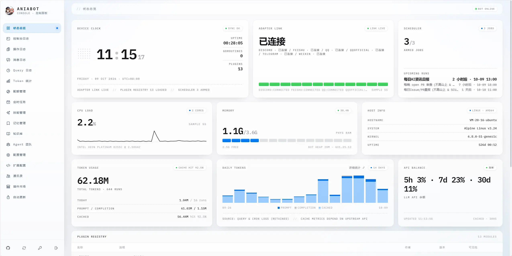

<div align="center">
  
  <h1>CocoBot</h1>
  <p>基于 AniaBot 定制的多平台机器人系统</p>
  <a href="https://github.com/oldplum/CocoBot">GitHub 仓库</a> |
  <a href="https://github.com/oldplum/CocoBot/releases">Releases 发布页</a> |
  <a href="https://aniabot-project.github.io/AniaBot/">📖 上游文档</a>
</div>


## 项目介绍

**CocoBot** 是一个基于 [AniaBot](https://github.com/AniaBot-Project/AniaBot) 定制开发的高性能、插件驱动型**多平台**机器人系统，在保持底层架构与上游完全兼容的同时，提供专属的定制化控制面板、双版本号管理与扩展能力。

- **基于开源底座**：核心引擎基于 [AniaBot](https://github.com/AniaBot-Project/AniaBot)，可平滑持续接收上游核心与功能更新
- **双版本管理**：独立的 CocoBot 发行版版本与底层 AniaBot 框架引擎版本同频并进
- **高性能**：基于 Go 语言，充分利用并发特性
- **多平台**：QQ（NapCat/LLBot WebSocket/HTTP，OneBot v11）+ 飞书（官方 SDK 长连接/Webhook）+ Telegram（Bot API 长轮询，无需公网地址）+ Discord（discordgo，Gateway WebSocket，无需公网地址）+ 微信（iLink bot，HTTP 长轮询，扫码登录，无需公网地址）等；新增平台只需实现一个适配器并注册，核心零改动
- **开箱即用**：内置 AI 对话（含 MCP/Skills/Tool Use）、复读机、每日新闻等实用插件
- **插件市场**：完全兼容官方插件市场 [AniaBot-Plugins](https://github.com/AniaBot-Project/AniaBot-Plugins)，面板「插件市场」可直接浏览、在线安装/升级/卸载社区插件并自动编译重启




## 自带与预装插件

CocoBot 默认集成了以下内置插件与实用扩展，开箱即用：

| 插件名称 | 标识 | 类型 | 功能说明 |
| :--- | :--- | :--- | :--- |
| **系统插件** | `pluginsys` | 系统核心 | 运行状态监控、启动通知、`/help` 帮助与 `/reboot` 重启 |
| **日志审计** | `pluginlog` | 系统核心 | 控制台与消息全量结构化日志记录与审计 |
| **消息拦截器** | `plugininterceptor` | 系统核心 | 权限与规则过滤、多群消息拦截控制 |
| **AI 智能对话** | `pluginaichat` | 核心功能 | 多 LLM 支持、上下文记忆、知识库外挂、MCP/Skills/Tool Use |
| **地震预警** | `plugineew` | 核心功能 | 实时推送全国地震预警与速报、日本 EEW 强震警报 |
| **每日简报** | `pluginnews` | 核心功能 | 每日定时获取并推送 60s 读懂世界/新闻精选 |
| **复读机** | `pluginrepeat` | 核心功能 | 群聊智能复读与高频消息统计 |
| **防撤回** | `antiwithdrawal` | 预装扩展 | QQ 群/私聊撤回消息侦测与私聊备份提醒 |
| **白名单管理** | `whitelist` | 预装扩展 | `/wl` 命令行管理群聊与私聊访问白名单 |

> 提示：如需更多功能，可在控制台「插件市场」一键安装来自 [AniaBot-Plugins](https://github.com/AniaBot-Project/AniaBot-Plugins) 的丰富社区插件。

## 快速开始

```bash
git clone https://github.com/oldplum/CocoBot.git
cd CocoBot
go mod tidy
cd web && npm ci && npm run build
```

直接运行，首次启动会自动写入默认配置，并在控制台打印 Web 控制面板的随机初始密码：

```bash
go run ./cmd
```

交叉编译：

```bash
make linux
make windows
```

登录 `http://127.0.0.1:7700`，按设置向导填写平台连接（NapCat/LLBot 地址 / 飞书 App ID、Secret / Telegram Bot Token / Discord Bot Token，微信无需连接配置、启用后扫码登录即可）、管理员 ID 与 AI 模型配置即可。默认启用 QQ 平台；在「配置 → 平台适配器」中勾选要启用的平台并填写对应连接信息后重启，即可多平台同时在线（如 QQ + 飞书 + Telegram + Discord + 微信）。

二进制部署时，可在面板「自动更新」页一键从 git 拉取最新代码、重新编译并自动重启（需配置源码目录，详见[上游文档](https://aniabot-project.github.io/AniaBot/guide/web-panel#自动更新)）。

## 二进制部署

可以直接到 [Releases](https://github.com/oldplum/CocoBot/releases) 下载对应平台的压缩包（linux amd64/arm64、macOS amd64/arm64、Windows amd64），解压即可运行。

首次启动会在当前目录生成 `data/` 存放数据库与配置，并在控制台打印 Web 控制面板的随机初始密码，登录 `http://127.0.0.1:7700` 完成配置。后续升级时重新下载替换二进制即可，数据不受影响。

## Docker 部署

镜像内置 Go / Node.js / git 工具链，面板的「自动更新」在容器内可直接使用。

使用 Docker Compose：

```bash
git clone https://github.com/oldplum/CocoBot.git && cd ./CocoBot
docker compose up -d
```

或直接使用镜像：

```bash
cd ~/Bot/
docker run -d --name cocobot \
  --net=host \
  -v ./data:/app/aniabot/data \
  -v ./skills:/app/aniabot/skills \
  jeanhua/aniabot:latest
```

详细配置和插件开发教程请查阅 **[AniaBot 文档站点](https://aniabot-project.github.io/AniaBot/)**。

## 插件市场

CocoBot 完全兼容并直接使用官方插件市场：面板「插件市场」页可浏览、在线安装 / 升级 / 卸载第三方插件（自动下载源码 → 编译 → 重启，容器内开箱即用）。

- **插件仓库**：[github.com/AniaBot-Project/AniaBot-Plugins](https://github.com/AniaBot-Project/AniaBot-Plugins) —— 官方插件市场，支持提交与使用社区插件
- **使用指南**：[插件市场使用文档](https://aniabot-project.github.io/AniaBot/guide/plugin-marketplace)
- **开发自己的插件**：[插件开发文档](https://aniabot-project.github.io/AniaBot/plugin/overview)，写好后到插件仓库提交 PR 即可发布

## 致谢与许可证

- **上游项目**：本项目基于开源机器人框架 [AniaBot](https://github.com/AniaBot-Project/AniaBot) 定制，衷心感谢原作者及开源社区贡献者的付出。
- **许可证**：本项目遵循与上游一致的 MIT 许可证，详见 [LICENSE](./LICENSE) 文件。
